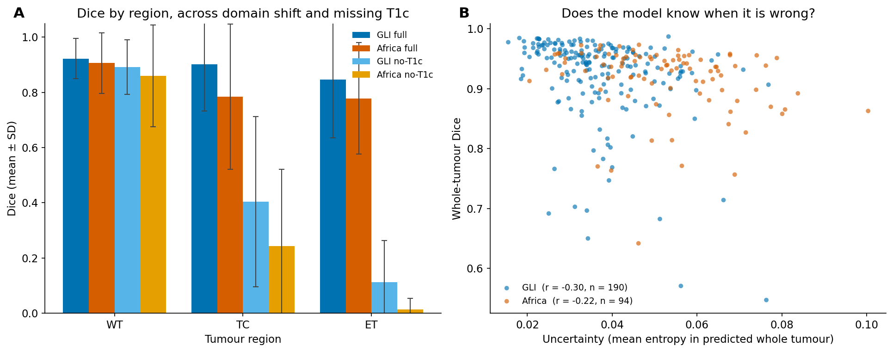

# brats-robustness

**Does a brain-tumour segmentation model trained on scans from high-resource
hospitals still work on scans from African hospitals, and when a scan type
(T1c) is missing — and does the model know when it is failing?**

An nnU-Net is trained on BraTS 2023 GLI (US/European glioma MRIs) and tested,
unchanged, on (1) held-out GLI cases, (2) BraTS-Africa cases, and (3) both of
those again with the contrast sequence (T1c) removed — the sequence many
low-resource sites skip. For every case we also record the model's own
uncertainty, to ask whether it flags its own mistakes.

## Data

- **BraTS 2023 GLI** (1,251 glioma cases) and **BraTS-Africa** (95 cases).
  Four MRI sequences per case (T1, T1c, T2, FLAIR) plus an expert mask;
  skull-stripped, co-registered, 1 mm isotropic, 240×240×155.
- **Split (by patient, seed 42):** train 869 / val 192 / internal test 190
  (GLI) / external test 95 (Africa). Africa is never used for training.
- Labels use BraTS regions: whole tumour (WT), tumour core (TC),
  enhancing tumour (ET).

## Method

- **Model:** nnU-Net v2, 3D full-resolution, region-based output
  (sigmoid per region).
- **This run is a deliberately small baseline** to fit a free Kaggle GPU:
  trained on a **600-case subset** (500 train + 100 val), **`nnUNetTrainer_50epochs`**,
  **fold 0 only**, **no test-time augmentation**. The two test sets (190 GLI,
  95 Africa) are unchanged.
- **Missing-T1c condition:** the T1c channel is replaced by a zero image with
  the same header, then the same model is run.
- **Uncertainty:** mean voxel entropy inside the predicted whole-tumour region.

## Results

Mean ± SD Dice and mean HD95 (mm), per region, per group:

| Group | Dice WT | Dice TC | Dice ET | HD95 WT | HD95 TC | HD95 ET |
|---|---|---|---|---|---|---|
| GLI, all sequences | 0.92 ± 0.07 | 0.90 ± 0.17 | 0.85 ± 0.21 | 5.9 | 4.6 | 4.1 |
| Africa, all sequences | 0.91 ± 0.11 | 0.78 ± 0.26 | 0.78 ± 0.20 | 7.3 | 9.9 | 7.0 |
| GLI, no T1c | 0.89 ± 0.10 | 0.40 ± 0.31 | 0.11 ± 0.15 | 9.4 | 20.5 | 22.8 |
| Africa, no T1c | 0.86 ± 0.18 | 0.24 ± 0.28 | 0.01 ± 0.04 | 9.9 | 29.9 | 36.9 |

HD95 uses the empty-mask rule: empty-vs-empty = 0 mm, ground-truth-vs-empty-prediction = excluded.
So the no-T1c TC/ET HD95 means are averaged only over the cases where the model predicted *something*
(empty predictions score Dice 0 and are dropped from HD95), which makes those distances look milder than
the Dice implies. The Africa-full uncertainty correlation below is over n = 94: one case had an empty
predicted whole-tumour region, so there was no entropy to average.

**What it shows:**
- **Domain shift (GLI → Africa):** with every sequence present, whole-tumour
  Dice barely moves (0.92 → 0.91), but tumour-core drops 0.90 → 0.78 and
  enhancing-tumour drops 0.85 → 0.78 — the fine-grained regions are where the
  domain gap bites.
- **Missing T1c:** whole-tumour Dice stays close to its full-sequence value,
  while tumour-core and enhancing-tumour Dice collapse —
  expected, because the enhancing rim is defined by the contrast agent that
  T1c carries.
- **Does it know when it is wrong?** Uncertainty vs whole-tumour Dice:
  Pearson r = -0.30 (GLI), -0.22 (Africa). Higher uncertainty does track
  lower Dice, so the model partly flags its own failures, but the relationship
  is modest (pooling the missing-T1c cases barely changes it: -0.30 / -0.26).

## Limitations

This is an honest, resource-constrained baseline, not a leaderboard entry:
600 of 1,061 training cases, 50 of the standard 1,000 epochs (~5% of full
training), a single fold, and no test-time augmentation. Absolute Dice is
therefore below published BraTS numbers (~0.90+ WT). The comparison is
**relative and fair**: the *same* model across GLI vs Africa and with vs
without T1c, so the drops measure robustness, not model weakness.

## Reproduce

1. `scripts/make_index.py` → `splits/index.csv` (patient-level split, seed 42).
2. `notebooks/02_convert.ipynb` → nnU-Net raw layout + `dataset.json` + `splits_final.json`.
3. Kaggle: `kaggle/01_preprocess/` (provenance) and `kaggle/02_train_eval/`
   (self-contained: preprocess 600 cases, train, predict the four groups,
   score). Plan in `docs/plan_C2.md`. Notebook 02 re-preprocesses the 600-case
   subset fresh into `/tmp`, so `kaggle/01_preprocess/` is kept for provenance
   only and is not a dependency of the results.
4. Outputs land in `results/` (`results.csv`, `figure.png`, training log,
   `progress.png`).

## Data use

BraTS 2023 data is used under its challenge terms (CC-BY-NC); see the
RSNA-ASNR-MICCAI BraTS 2023 and BraTS-Africa references. Not for clinical use.
